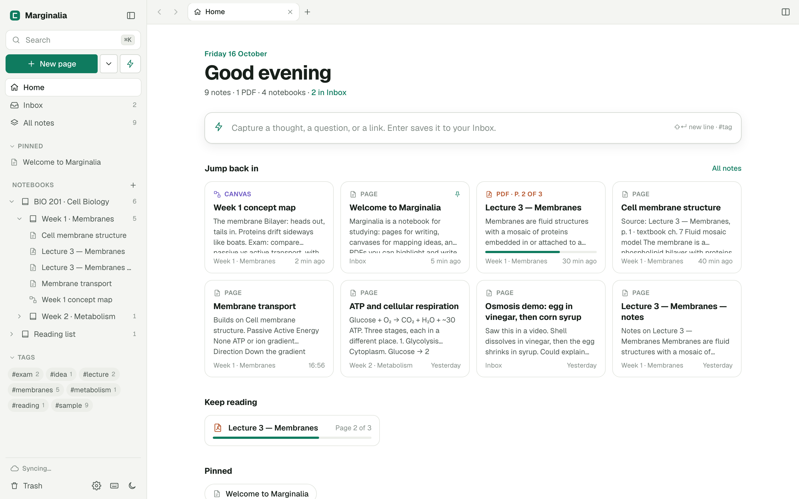

# Marginalia

A local-first notebook for studying from online courses, lectures, articles and PDFs. Write pages, map ideas on an infinite canvas, and highlight and draw on your PDFs, all linked together and searchable in one place.

No accounts, no tracking, no AI. Your notes live in your browser and, if you want, on your own server.

<picture>
  <source media="(prefers-color-scheme: dark)" srcset="docs/screenshot-dark.png">
  
</picture>

## Documentation

- [User guide](docs/user-guide.md): how to use every feature, with keyboard shortcuts and troubleshooting.
- [Technical architecture](docs/architecture.md): how the app is built, including the data model, sync protocol, server API and security model.

## Features

- **Pages** with a formatting toolbar, Markdown shortcuts, a `/` block menu, checklists, tables, callouts, images you can resize, and sketch blocks you draw in with a pen or stylus.
- **Code blocks** that keep indentation when you paste YAML, JSON, Terraform, shell scripts or other code, with a language label, copy button and auto-indent.
- **Infinite canvas** with cards, stickies, note cards, frames, arrows, and pen and highlighter ink.
- **PDF reader and annotator**: highlights and underlines with comments, pen, highlighter, text boxes, eraser, outline, find, and quote-to-notes. Dark pages invert the text but keep figures and photos in their original colours.
- **Organisation**: nested notebooks (class, chapter, topic) with colours that their sections share, tags, pinned notes, an Inbox and a Trash.
- **Links between notes**: `[[wiki links]]`, backlinks and an outline panel.
- **Fast navigation**: tabs, split view, back and forward, a quick switcher with universal search across notes and PDF text (`⌘K`), and a command palette (`⌘⇧P`).
- **Quick capture** (`⌘⇧Space`) sends a thought straight to your Inbox.
- **Version history**: automatic snapshots and named versions (`⌘S`), with a diff view and restore.
- **Export and import**: Markdown, HTML, Word, plain text, PNG, SVG, PDF with your annotations burned in, and a full ZIP backup. Import Markdown, text, HTML, PDFs, whole folders and backups.
- **Local-first sync**: each browser keeps a full copy, and an optional small server keeps your devices in sync.
- Light and dark themes, built for keyboard and stylus. Press `⌘/` (`Ctrl /` on Windows and Linux) in the app for every shortcut.

## Quick start

You need Python 3 and nothing else.

```bash
git clone https://github.com/ovidiulazarescu/marginalia.git
```

```bash
cd marginalia && python3 serve.py
```

This opens http://localhost:5178 with a few sample notes to explore. Use `--port` to change the port and `--data` to choose where notes are stored.

There's no build step: the app is plain ES modules. Its libraries (Preact, pdf.js, pdf-lib, perfect-freehand, MiniSearch, jsdiff and JSZip) load from jsDelivr at pinned versions, and fonts load from Google Fonts, so the first load needs an internet connection.

## How your notes are stored

**In the browser.** Every browser keeps a full copy of your notes in IndexedDB, so the app is fast and an open tab keeps working if your connection drops. Changes upload when it returns. Loading the app from scratch needs the server to be reachable.

**On the server.** `serve.py` serves the app and stores a copy of your notes: notebooks, notes, versions and PDF text go into SQLite at `data/marginalia.db`, and PDFs into `data/files/`. It uses only the Python standard library.

**Sync.** Browsers sync with the server in the background: every 30 seconds, shortly after each edit, and when you come back online. The status shows at the bottom of the sidebar and in **Settings → Sync**.

- **Conflicts.** If two devices change the same note, the newest edit wins and the other is kept in that note's version history, labelled "From another device".
- **Server resets.** Each server database has a permanent ID. If the server is reset or its data folder replaced, every browser that connects notices the new ID and uploads what it holds, so the server is rebuilt from your devices. A device's copy can be older than the server's was, so notes you deleted forever after that device last synced may come back; delete them again.
- **Without the server.** If you serve the files with any static web server instead, there's no sync and notes stay in that browser.

**Backups.** **Settings → Download full backup** works either way.

## Self-hosting

### Docker Compose

From the repo root:

```bash
docker compose -f deploy/docker-compose.yml up -d
```

[`deploy/docker-compose.yml`](deploy/docker-compose.yml) runs `serve.py` in the official `python:3.12-alpine` image on port 8095. It mounts the checkout read-only and keeps notes in `deploy/data/`.

### Security

The server has no user accounts. Anyone who can reach its port can read and change your notes, so either keep it on your local network or put a login in front of it.

- **Sync token.** Set `MARGINALIA_TOKEN` (or `--token`) to a long random value, for example the output of `openssl rand -hex 24`. Every API request must then carry it, and you enter it once per browser under **Settings → Sync**. Without a token, other websites open in your browser can send changes to a server they can reach, even one on `localhost`, so set one anywhere you don't fully trust. The [architecture document](docs/architecture.md#security-model) has the details.
- **Access login.** When you expose the server to the internet, put an authenticating proxy in front of it, such as Cloudflare Access (see below). The app notices when that login expires and shows **Sign-in expired** in the sidebar; a reload signs you back in.

### TrueNAS SCALE, with an optional Cloudflare tunnel

These steps run the server as a Docker app on TrueNAS SCALE 24.10 or later. Steps 1–3 make it available on your local network. Steps 4–5 are optional and make it reachable from anywhere through a Cloudflare Zero Trust tunnel.

1. **Create two datasets**, for example:
   - `/mnt/tank/apps/marginalia/app` for the code
   - `/mnt/tank/apps/marginalia/data` for your notes. A separate dataset lets snapshots and replication protect your notes on their own.

   A `data/` folder inside the checkout also works, because git ignores it.

2. **Clone the repo into the app dataset**, so updating later is a `git pull`. The folder must be empty or not exist yet:

   ```bash
   git clone https://github.com/ovidiulazarescu/marginalia.git /mnt/tank/apps/marginalia/app
   ```

3. **Create the app.** Go to **Apps → Discover Apps → ⋮ → Install via YAML** and paste:

   ```yaml
   services:
     marginalia:
       image: python:3.12-alpine
       restart: unless-stopped
       working_dir: /app
       command: ["python", "-u", "serve.py", "--host", "0.0.0.0", "--port", "8095", "--data", "/data", "--no-open"]
       environment:
         MARGINALIA_TOKEN: ""
       ports:
         - "8095:8095"
       volumes:
         - /mnt/tank/apps/marginalia/app:/app:ro
         - /mnt/tank/apps/marginalia/data:/data
   ```

   Change `tank` to your pool name and `8095` to a free port, then open `http://TRUENAS_IP:8095`. The app's logs should say `Marginalia is running` and show `Data folder: /data`. Set `MARGINALIA_TOKEN` as described under [Security](#security).

4. **Optional: route a subdomain.** In Cloudflare Zero Trust go to **Networks → Tunnels**, choose your tunnel, then **Public Hostname → Add**. Set a subdomain (for example `notes`) and your domain, with service `HTTP` and URL `TRUENAS_IP:8095`. If `cloudflared` isn't running yet, install the **Cloudflared** app from the TrueNAS catalog with your tunnel token.

5. **Restrict access (required if you did step 4).** The tunnel makes the server public. Go to **Zero Trust → Access → Applications → Add → Self-hosted**, enter the hostname, and add an **Allow** policy that includes only your email address, with One-time PIN as the login method. Sync requests go to the same address, so this login protects them too. It doesn't cover direct access on your LAN at `TRUENAS_IP:8095`; the token from step 3 does.

**Updating.** Run `git pull` in the app dataset, then restart the app so the server picks up any changes to `serve.py`. Browsers load the new app files on their next reload.

**Cloudflare caching.** Cloudflare's default browser cache setting overrides the server's, so browsers may keep old app files for up to 4 hours after an update. Add a rule under **Caching → Cache Rules**: hostname equals your subdomain, cache eligibility **Bypass cache**, browser TTL **Respect origin**. Until then, `⌘⇧R` (`Ctrl Shift R`) forces a fresh load.

**Backups.** Snapshot the data dataset. `marginalia.db` uses SQLite's WAL mode, and a snapshot captures it together with its `-wal` file as a consistent copy.

### First sync on a new address

The first browser to connect to an empty server uploads the notes it already has. A new device starts from the server's copy instead, so it doesn't add its own sample notes.

Notes in a browser that used a different address (such as `localhost`) aren't on the server. To move them:
1. On the old address, use **Settings → Download full backup**.
2. On the synced address, use **Restore from backup**.

They upload on the next sync.

## Project layout

| Area | Files |
| --- | --- |
| App shell, state, navigation, notebooks, tags | `js/app.js`, `js/store.js`, `js/sidebar.js`, `js/actions.js` |
| Page editor and sketch blocks | `js/editor.js`, `js/ink.js` |
| Markdown conversion, sanitising, code detection, links | `js/md.js` |
| Infinite canvas | `js/canvas.js` |
| PDF reader, annotations, dark pages | `js/pdfview.js`, `js/pdfdark.js` |
| Search, quick switcher, command palette, quick capture | `js/search.js`, `js/palette.js`, `js/capture.js` |
| Home, list views, backlinks, outline, history, settings | `js/views.js` |
| Export and import | `js/export.js` |
| Local storage, change tracking, sync | `js/db.js`, `js/sync.js` |
| Server: app files plus sync API on SQLite (`/api/health`, `/api/push`, `/api/changes`, `/api/files/<id>`) | `serve.py` |
| Library versions | `js/lib.js` |

`artifact.html` is a minimal entry page for running the app inside a hosted HTML viewer, where notes stay in that browser.

## License

[MIT](LICENSE)
