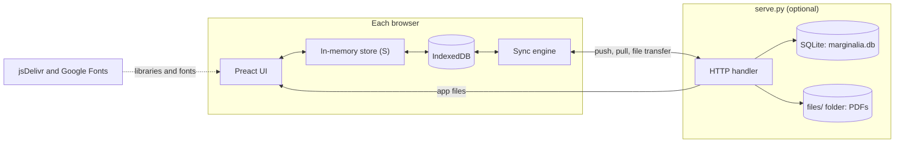
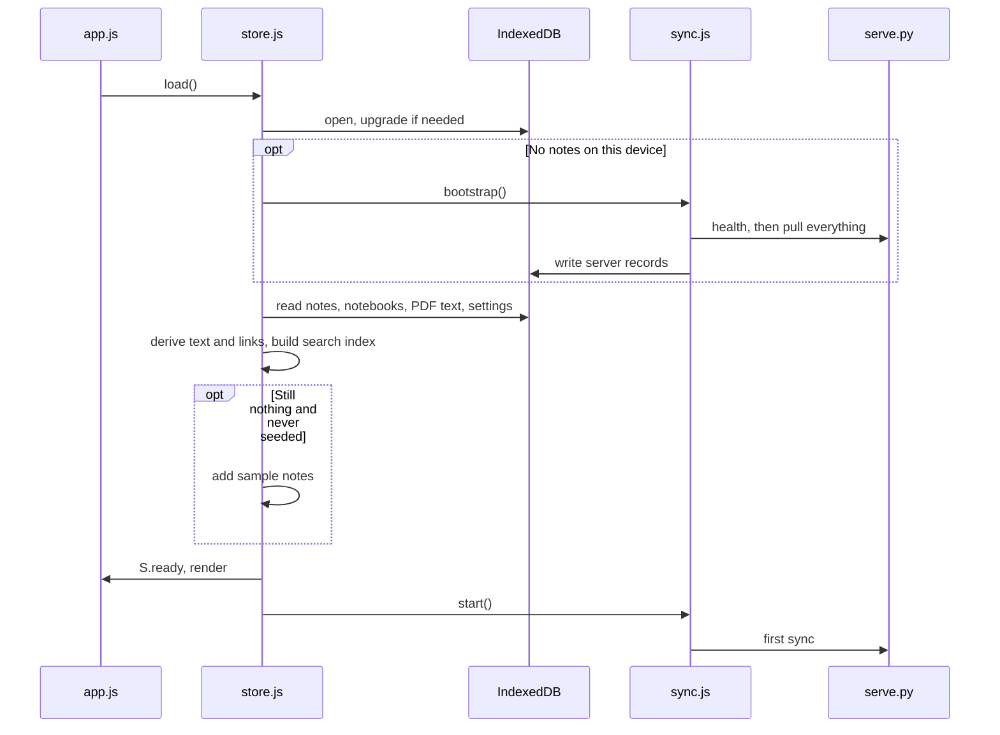
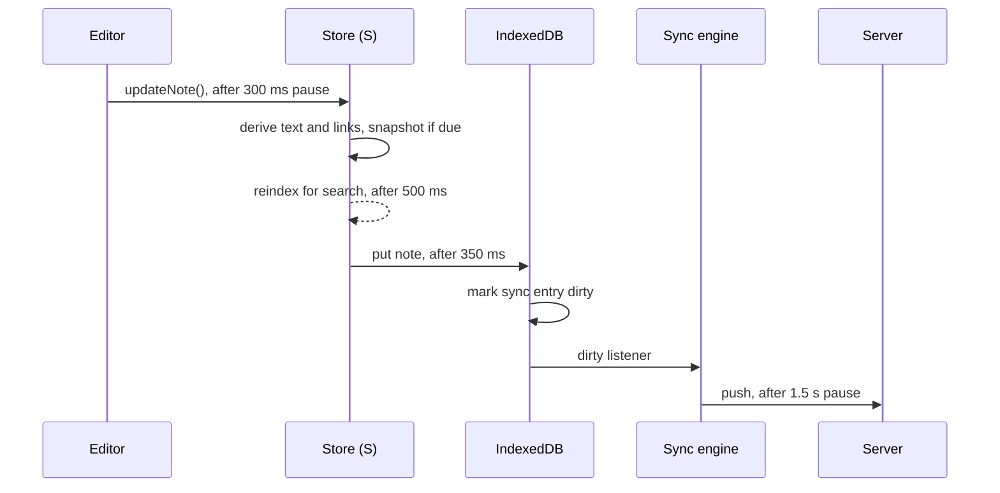
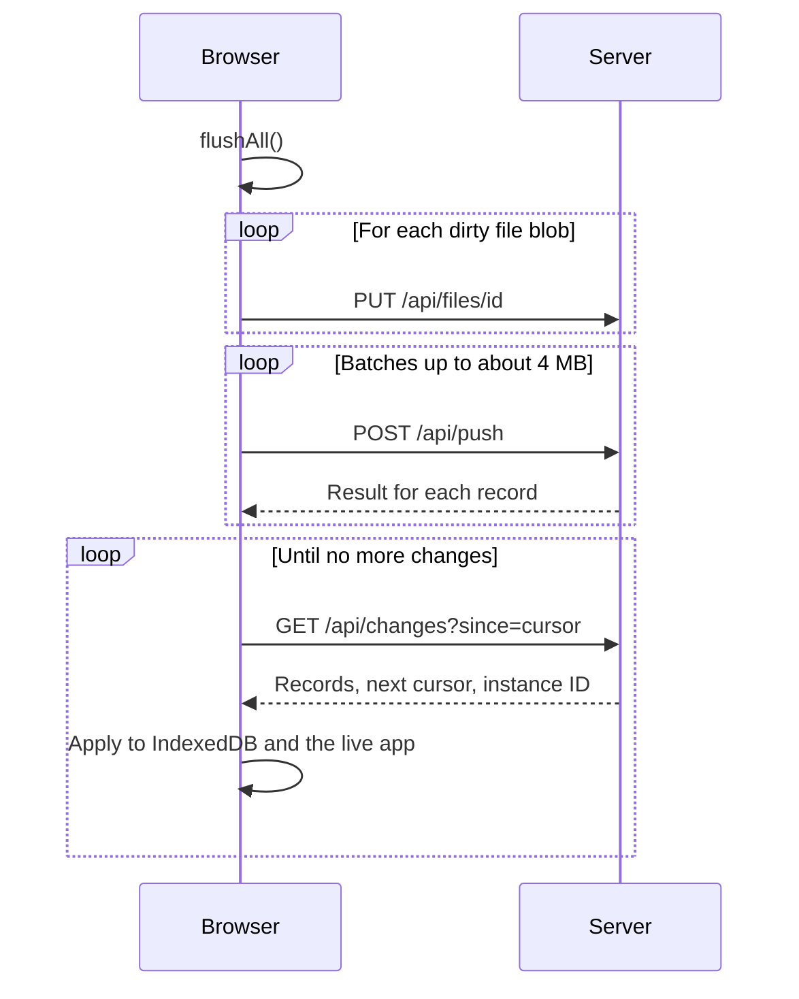
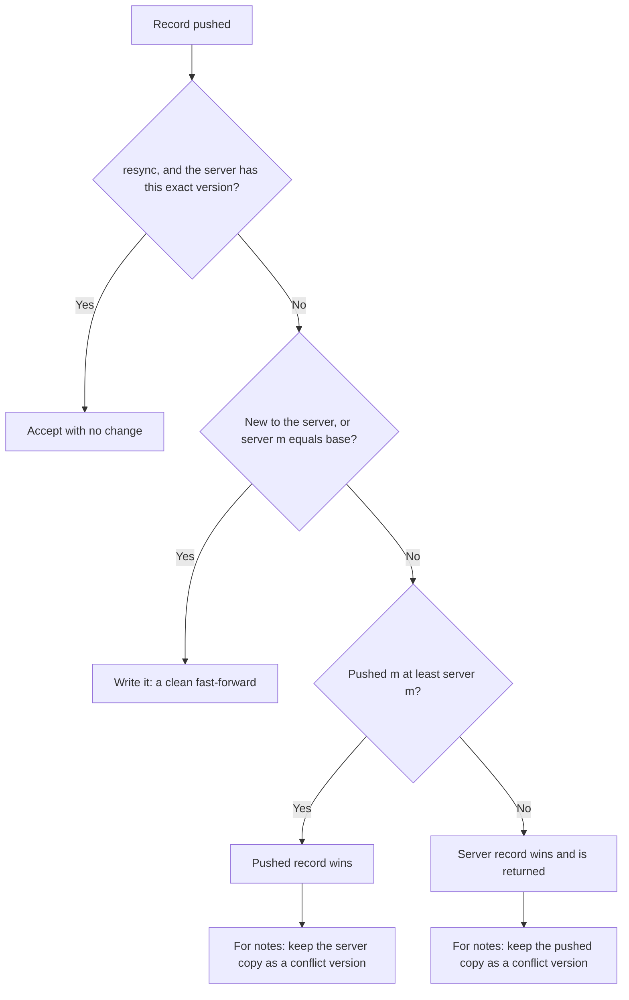
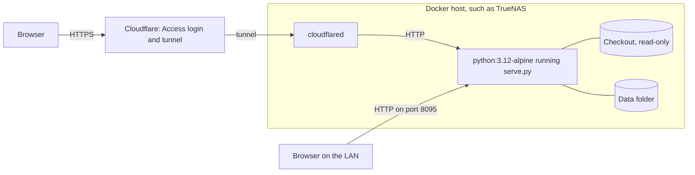

# Marginalia technical architecture

This document explains how Marginalia is built and why, for anyone reading, changing or self-hosting the code. For how to use the app, see the [user guide](user-guide.md). For installation, see the [README](../README.md).

## Contents

- [Overview](#overview)
- [Design principles](#design-principles)
- [Technology](#technology)
- [Repository layout](#repository-layout)
- [Frontend architecture](#frontend-architecture)
- [Data model](#data-model)
- [Feature subsystems](#feature-subsystems)
- [Sync](#sync)
- [Server](#server)
- [Security model](#security-model)
- [Deployment](#deployment)
- [Performance](#performance)
- [Known limitations](#known-limitations)
- [Working on the code](#working-on-the-code)

## Overview

Marginalia is a browser application with an optional small server. The browser is the primary home of the data: it holds a complete copy of the user's notes in IndexedDB and works against that copy. The server serves the app's files and stores a second copy, so several devices can stay in step.



Without the server, the app runs from any static web server, and notes stay in that browser. `js/sync.js` detects this and turns itself off.

## Design principles

These choices explain most of the code's shape.

- **Local first.** Reads and writes go to the browser's own data, never over the network. The network is only ever a background concern, so typing and navigation stay fast whatever the connection is doing.
- **No build step.** The source files are what the browser runs. There's no bundler, transpiler or `node_modules`, so cloning the repo is the entire setup.
- **No server dependencies.** `serve.py` uses only the Python standard library, so hosting needs nothing beyond a Python image.
- **Data that outlives the app.** Export covers open formats, and a full backup is a ZIP of JSON and PDFs.
- **Server as a replica.** The server can be rebuilt from any browser. That makes it cheap to reset and removes the need for server-side business logic beyond conflict handling.

## Technology

| Concern | Choice | Version |
| --- | --- | --- |
| UI | [Preact](https://preactjs.com/) with [htm](https://github.com/developit/htm) tagged templates | htm 3.1.1 standalone build |
| PDF rendering and text | [pdf.js](https://mozilla.github.io/pdf.js/) | 4.4.168 |
| PDF writing | [pdf-lib](https://pdf-lib.js.org/) | 1.17.1 |
| Pen strokes | [perfect-freehand](https://github.com/steveruizok/perfect-freehand) | 1.2.2 |
| Full-text search | [MiniSearch](https://lucaong.github.io/minisearch/) | 7.1.0 |
| Version diffs | [jsdiff](https://github.com/kpdecker/jsdiff) | 5.2.0 |
| ZIP files | [JSZip](https://stuk.github.io/jszip/) | 3.10.1 |
| Fonts | Geist, Geist Mono and Literata from Google Fonts | |
| Browser storage | IndexedDB | Schema version 2 |
| Server | Python 3 standard library: `http.server`, `sqlite3` | Python 3.12 in the Docker setup |
| Server storage | SQLite in WAL mode, plus plain files | |

All libraries load from jsDelivr at exact versions, through one file, [`js/lib.js`](../js/lib.js). pdf.js, pdf-lib and JSZip are heavy, so they load the first time they're needed.

## Repository layout

```
index.html              Entry page
artifact.html           Minimal entry page for hosted HTML viewers
styles.css              All styles, with theme tokens at the top
serve.py                Server: app files, sync API, SQLite and file storage
deploy/                 Docker Compose file
docs/                   This documentation
js/
  app.js                Root component, global shortcuts, drag-and-drop import
  lib.js                Third-party imports, pinned to exact versions
  store.js              App state, notes, notebooks, navigation, versions, PDFs
  db.js                 IndexedDB wrapper and change tracking
  sync.js               Background sync engine
  sidebar.js            Sidebar
  views.js              Panes, tabs, note view, lists, Home, details panel, settings
  actions.js            Commands shared by menus, the palette and shortcuts
  dialogs.js            Menus, dialogs, toasts, keyboard help
  palette.js            Search, quick switcher, command palette, note picker
  search.js             Search index and query language
  capture.js            Quick capture
  meta.js               Tags and notebook chip under note titles
  editor.js             Page editor
  md.js                 HTML sanitising, Markdown conversion, code detection, autolinks
  templates.js          Page templates
  ink.js                Pen strokes and sketch blocks
  canvas.js             Infinite canvas
  pdfview.js            PDF reader and annotator
  pdfdark.js            Dark PDF page rendering
  export.js             Export, backup, restore and import
  seed.js               First-run sample notes
  icons.js              Inline SVG icons
  util.js               Shared helpers
```

## Frontend architecture

### State and rendering

All application state lives in one mutable object, `S`, exported by [`js/store.js`](../js/store.js):

| Field | Holds |
| --- | --- |
| `S.notes`, `S.notebooks` | Maps of every note and notebook, by ID |
| `S.pdfText` | Extracted text of each PDF, by note ID |
| `S.settings` | User settings |
| `S.ws` | Workspace: panes, tabs, history, expanded notebooks |
| `S.ui` | Transient state: palette, dialogs, menus, toasts |
| `S.sync` | Sync status, shared with `js/sync.js` |
| `S.rev` | Counter that goes up on each change |

Reactivity is deliberately simple. Code mutates `S`, then calls `emit()`, which batches in a microtask and notifies subscribers. The `App` component subscribes through `useStore()` and re-renders from the top. Views read `S` directly, so there are no selectors or per-component subscriptions.

Components that manage their own DOM, chiefly the page editor, canvas and PDF pages, keep local state and use refs. They avoid fighting the top-down render by reloading their content only when `note.rev` changes, which marks a change that came from outside the component, such as a sync, restore or quick capture.

### Startup



The bootstrap step is why a new device shows the server's notes instead of adding its own samples. If the server is empty, the device seeds as usual and uploads the samples.

### From keystroke to server

An edit passes through several stages, each debounced so the app can keep up with fast typing.



Before anything that needs up-to-date content, such as navigating away, exporting or syncing, `flushAll()` forces pending saves through. Editors register a callback in `flushers` so their unsaved keystrokes are included. The app also flushes on `beforeunload` and when the page is hidden.

### Navigation

There are no URL routes. A location is a string held on a tab:

| Value | View |
| --- | --- |
| `home`, `inbox`, `all`, `trash`, `settings` | Built-in views |
| `nb:<id>` | Notebook |
| `tag:<name>` | Tag |
| Any note ID | That note |

The workspace holds one or two panes, each with tabs, and each tab has its own back and forward stack, capped at 60 entries. The workspace saves to IndexedDB, so it survives reloads. It isn't synced.

### Theming

[`styles.css`](../styles.css) defines colours as CSS variables on `:root`. Dark values are defined twice: in a `prefers-color-scheme` block for the System theme, and on `[data-theme="dark"]` for an explicit choice. Writing font and page width use the same technique through `data-font` and `data-width` on the root element.

Notebook colours follow the pattern too. Each colour is a `--nb-<key>` token with light and dark values. An element showing a notebook's colour gets `--nbc` set inline, through `nbStyle()`, and CSS uses `var(--nbc, <fallback>)`. `nbColor()` walks up the notebook's parents to find the nearest colour, and accepts only keys listed in `NB_COLORS`.

## Data model

### IndexedDB stores

The database is named `marginalia`, at schema version 2.

| Store | Key | Synced | Contents |
| --- | --- | --- | --- |
| `notes` | `id` | Yes | Notes of all types |
| `notebooks` | `id` | Yes | Notebook tree |
| `versions` | `id`, indexed by `noteId` | Yes | Version history |
| `files` | `id` | Metadata, with blobs transferred separately | PDF files |
| `pdftext` | `id` (the note ID) | Yes | Text of each PDF page |
| `kv` | `key` | No | Settings, workspace and sync bookkeeping |
| `sync` | `key`, indexed by `dirty` | No | One change-tracking entry per synced record |

If IndexedDB is blocked, for example in some private windows, `js/db.js` falls back to an in-memory store and the app shows a warning.

### Notes

```js
{
  id, type,              // type is 'page', 'canvas' or 'pdf'
  title,
  notebookId,            // null means the Inbox
  tags: [],
  pinned,
  created, updated, opened,   // millisecond timestamps
  trashed,               // null, or the time it was trashed
  content,               // depends on type, below
  view,                  // last viewport: canvas pan and zoom, or PDF page
}
```

`text`, `links`, `words` and `rev` also exist in memory. They're derived from the content on load, and `strip()` removes them before storing.

`content` depends on the type:

```js
// page
{ html }

// canvas
{
  items: [{ id, kind, x, y, w, h, ... }],   // kind: text, sticky, note, image, frame
  strokes: [{ id, tool, color, size, sim, points }],
  edges: [{ from, to }],
  view: { x, y, z },
}

// pdf
{ fileId, fileName, pages, lastPage, companionId, ann: [...] }
```

PDF annotations use page coordinates, in PDF points at 100% zoom, so they're independent of the current zoom:

```js
{ id, created, kind: 'hl', page, style, rects, color, text, comment }   // style: highlight, underline, strike
{ id, created, kind: 'ink', page, tool, color, size, sim, points }
{ id, created, kind: 'text', page, x, y, w, size, color, text }
```

### Page HTML

A page's content is sanitised HTML, which keeps editing simple and makes the stored form easy to render. On top of standard tags, it uses a few conventions:

| Markup | Meaning |
| --- | --- |
| `<a class="wikilink" data-note-id data-page>` | Link to a note, optionally to a PDF page |
| `<ul class="tasks"><li data-checked>` | Checklist |
| `<div class="callout">` | Callout |
| `<div class="ink-block" data-ink>` | Sketch, with its strokes as JSON |
| `<pre data-lang>` | Code block |
| `` | Image with a percentage width and alignment. The source is an inline data URL |

### Other records

```js
// Notebook
{ id, name, parentId, color, created }

// Version
{ id, noteId, ts, title, type, content, text, words, reason, label, sig }
// reason: auto, manual, restore or conflict. sig is a hash used to skip duplicates.

// File
{ id, name, size, blob }

// Sync entry
{ key, store, id, dirty, deleted, m, b, up, resync }
```

The sync entry fields are explained under [Sync](#sync).

## Feature subsystems

### Page editor

[`js/editor.js`](../js/editor.js) is a `contenteditable` surface using the browser's `execCommand`. That's a legacy API, but it gives native undo, caret handling and IME input for free. The editor adds the following around it:

- **Input rules** in `onInput`: Markdown line prefixes and inline marks are replaced as they're typed.
- **Popups** for `/` and `[[`, positioned at the caret.
- **Smart paste** in `onPaste`, trying in order: images, text inside a code block, code detection, a lone URL, HTML, Markdown, then plain paragraphs. `detectCode()` in [`js/md.js`](../js/md.js) uses line-shape heuristics to pick out code, and a language where it can.
- **Sanitising** on the way in. Everything loaded or pasted goes through `sanitizeHTML()`, which rebuilds the content from an allowlist of tags and attributes. It keeps only `http`, `https` and `mailto` links, and `https` or `data:image` image sources.
- **Hydration** after loading: sketch blocks become interactive, image widths are applied, and web addresses become links.
- **Overlays** for selected images and code blocks, which live outside the editable area, so they never end up in saved content.

`serializeEditor()` removes the interactive UI before saving.

### Ink

[`js/ink.js`](../js/ink.js) is shared by canvases, PDFs and sketch blocks. Strokes store raw points, and perfect-freehand turns those into a filled outline when drawing. Paths are cached in a `WeakMap`. Coalesced pointer events give dense strokes on fast pen movement. The `sim` flag marks input without real pressure, such as a mouse, so that pressure is simulated.

### Canvas

[`js/canvas.js`](../js/canvas.js) renders cards as HTML elements and ink as SVG, inside a single element transformed by the current pan and zoom. A pointer gesture becomes a small state object (`pan`, `draw`, `erase`, `move`, `resize`, `marquee`, `link`, `frame`, `pinch`), updated on each move and committed on release. Undo uses whole-document snapshots.

Frames have no parent-child relationship with their contents. Moving a frame moves whatever lies geometrically inside it at that moment.

### PDF reader

[`js/pdfview.js`](../js/pdfview.js) gives each page a `<canvas>`, a pdf.js text layer for selection, and an SVG and HTML overlay for annotations. Pages render only when near the viewport.

Selecting text produces rectangles from the browser's selection, converted to page coordinates and merged by line. `importPdf()` extracts the text of each page in the background, for search and find.

[`js/export.js`](../js/export.js) writes annotations into a copy of the PDF with pdf-lib. It flips the y axis, because PDF coordinates start at the bottom left, and uses a Multiply blend so highlights don't hide the text.

### Dark PDF pages

Inverting a page would also invert photos and diagrams, so [`js/pdfdark.js`](../js/pdfdark.js) works in two passes:

1. Render the page normally, then invert its lightness while keeping hue, fitting values between near-black and near-white.
2. Walk the page's pdf.js operator list, tracking the transformation matrix, to find where each image lands. Each image is then repainted in its original colours from the pdf.js image objects.

Images over 60% of the page are skipped, because those are usually scans, and a scan should be darkened like any other page.

### Search

[`js/search.js`](../js/search.js) keeps one MiniSearch index, holding one document per note and one for each PDF page. Title matches get the highest boost, then tags. Queries use prefix matching, plus fuzzy matching for terms over four characters.

A second pass adds a subsequence match on titles, which makes the quick switcher feel forgiving. `parseQuery()` extracts the filters (`#tag`, `type:`, `in:`, `is:pinned`), and those are applied to each result. The index is rebuilt in memory at startup and updated incrementally.

### Links and backlinks

Each note's outgoing links are derived in `noteLinks()`:

- Pages: `data-note-id` attributes and any `[[Title]]` text.
- Canvases: note cards and `[[Title]]` text.
- PDFs: the companion notes page and `[[Title]]` text.

Backlinks are a scan of all notes in memory. Links resolve by ID, or by title for bare `[[Title]]` text, and a title change triggers a debounced re-resolve (`relinkByTitle`).

### Version history

`updateNote()` takes a snapshot before a content change if the last one is older than the configured interval. Leaving a changed note takes another. Identical content is skipped using a hash. The newest 150 or so automatic versions are kept per note, and named versions are never pruned.

Versions hold full copies of the content rather than deltas. That uses more space, but restoring is trivial and each version stands alone. Diffs are computed on demand with `diffWords` over the text.

### Import, export and backup

[`js/export.js`](../js/export.js) handles all of these. A backup is a ZIP containing `marginalia.json` (notes, notebooks, versions, PDF text and file metadata) and `files/<id>.pdf`.

`restoreBackup()` merges rather than replaces: a note is written only if it's new or newer than the local copy. Notebooks, versions and PDF text from the backup overwrite local records with the same IDs. Restored records go through normal change tracking, so they upload on the next sync.

## Sync

### Change tracking

Every write to a synced store through `db.put`, `db.putMany` or `db.del` also updates that record's entry in the `sync` store:

| Field | Meaning |
| --- | --- |
| `key` | `store/id` |
| `dirty` | 1 if the record has a change to push |
| `deleted` | 1 if the change is a deletion |
| `m` | Local modification time of the latest change |
| `b` | Base: the server's `m` when this device last saw the record |
| `up` | 1 once a file's blob has been uploaded |
| `resync` | 1 if this is a re-send after a server change, not a new edit |

Writes that come from the server pass `{ remote: true }`, so they aren't pushed back.

### The sync cycle

`syncNow()` runs a flush, a push and then a pull. It runs every 30 seconds, 1.5 seconds after the last local change, when the tab becomes visible and when the browser comes back online. Only one run happens at a time: a request during a run sets a flag for one more pass.



**Push.** Each batch is capped at about 4 MB. A file's bytes go first, and its metadata record follows in a normal batch. The `up` flag means an interrupted sync doesn't upload a PDF twice. A note edited while its push is in flight stays dirty, because `m` no longer matches.

**Pull.** The server gives every write a rising sequence number, and the browser stores the last one it has read as `syncCursor`. Records with a local edit waiting are skipped, because the next push will settle them. Records this browser already has are also skipped. `applyRemote()` then updates memory and the search index, and increments `rev` so open editors reload.

Blobs are never pulled in bulk. `getFile()` downloads a PDF the first time it's opened and keeps it locally.

### Conflict resolution

Conflicts are settled per record, on the server, during `push`. Each record carries its time `m` and its base `b`.



Conflict versions have `reason: 'conflict'`, and the history shows them as **From another device**. They aren't created for re-sends or deletions. Only notes get them: for notebooks, versions and files, the loser is simply dropped.

### Server identity and recovery

Each server database generates a permanent `instance` ID, returned by `/api/health` and `/api/changes`. A browser stores the ID it last saw. If the ID changes, because the server was reset, its data folder was replaced, or the browser points somewhere new, `adoptServer()`:

1. Marks every clean record dirty, with `resync` set and `b = m`.
2. Marks every file for re-upload.
3. Drops clean deletion markers, and queues any record that has no sync entry.
4. Resets the cursor to 0, so the server's copy is read back from the start.

The `resync` flag stops these re-sends from creating false conflict versions. The server is therefore disposable: a new, empty server is rebuilt by the next browser that connects.

The trade-off is that a stale device can resurrect notes that were deleted forever after it last synced, because the record of the deletion went with the old server. This is documented in the README.

### Connection states

`S.sync.state` drives the sidebar indicator:

| State | Cause |
| --- | --- |
| `checking` | Starting up |
| `syncing` | A sync is running |
| `idle` | Up to date |
| `offline` | The request failed or timed out; retried every 30 seconds |
| `token` | The server answered 401, or wants a token and none is set |
| `expired` | A redirect, which means a login proxy's session ended |
| `error` | Any other failure |
| `off` | No sync server: `/api/health` was missing or didn't identify as Marginalia |

Requests use `redirect: 'manual'`, because following a Cloudflare Access redirect would fail cross-origin. Seeing the redirect is how the app knows a session expired.

## Server

[`serve.py`](../serve.py) is a single file built on `ThreadingHTTPServer`. Handlers on different threads share one SQLite connection, guarded by a lock.

### Configuration

| Flag | Environment variable | Default | Purpose |
| --- | --- | --- | --- |
| `--host` | `MARGINALIA_HOST` | `127.0.0.1` | Address to listen on. Use `0.0.0.0` in Docker |
| `--port` | `MARGINALIA_PORT` | `5178` | Port |
| `--data` | `MARGINALIA_DATA` | `data/` beside `serve.py` | Folder for the database and PDFs |
| `--token` | `MARGINALIA_TOKEN` | Empty | Bearer token required for `/api` |
| `--allowed-hosts` | `MARGINALIA_ALLOWED_HOSTS` | Empty | Comma-separated domain names this server answers to. See [Cross-site requests](#cross-site-requests) |
| `--no-open` | | Off | Don't open a browser on start |

### Storage

```sql
CREATE TABLE records (
  store TEXT NOT NULL,      -- notes, notebooks, versions, files or pdftext
  id TEXT NOT NULL,
  data TEXT,                -- JSON, or NULL for a deletion
  m INTEGER NOT NULL,       -- modification time from the client
  deleted INTEGER NOT NULL DEFAULT 0,
  seq INTEGER NOT NULL,     -- rising write number, used by /api/changes
  PRIMARY KEY (store, id)
);
CREATE INDEX records_seq ON records (seq);
CREATE TABLE meta (k TEXT PRIMARY KEY, v TEXT);   -- holds the instance ID
```

The server treats records as opaque JSON. It reads only a few fields when building a conflict version. Deletions stay as tombstones, so other devices learn about them. PDF blobs are stored at `files/<id>`, and are removed when their `files` record is deleted.

### API

Paths outside `/api/` serve the app's files. Every API route except `/api/health` requires `Authorization: Bearer <token>` when a token is set.

Two checks run first, on app files and API routes alike, and both answer `403` with an `error` message and close the connection:

- **Host.** Every request's `Host` header has to pass the rules under [Cross-site requests](#cross-site-requests).
- **Origin.** A `POST` or `PUT` with an `Origin` header has to come from the address it was sent to. Requests with no `Origin` pass, because browsers always send one on these methods, so they come from scripts and tools.

#### `GET /api/health`

Identifies the server. It never requires a token, so the app can tell that one is needed.

```json
{ "app": "marginalia", "auth": false, "ok": true, "instance": "310fb003203544df8116f087055a0c1c" }
```

#### `POST /api/push`

Sends changed records, up to 64 MiB per request. The `Content-Type` must be `application/json`, with or without parameters such as `charset`. Anything else gets `415`.

```json
{
  "records": [
    { "store": "notes", "id": "n1", "m": 1000, "b": null, "deleted": false, "resync": false, "data": { "id": "n1", "title": "A" } }
  ]
}
```

The response has one result per record, in order. A rejected record comes back with the server's copy:

```json
{
  "results": [
    { "ok": true },
    { "ok": false, "record": { "store": "notes", "id": "n2", "data": { "id": "n2", "title": "A" }, "m": 1000, "deleted": false } }
  ]
}
```

#### `GET /api/changes?since=<seq>&limit=<n>`

Returns records written after `since`, oldest first. `limit` is at most 1,000, and defaults to 400.

```json
{
  "records": [
    { "store": "notes", "id": "n1", "data": { "id": "n1", "title": "A" }, "m": 1000, "deleted": false }
  ],
  "next": 1,
  "more": false,
  "instance": "310fb003203544df8116f087055a0c1c"
}
```

#### `GET /api/stats`

Counts live records by store, for example `{ "notes": 1, "versions": 1 }`.

#### `GET`, `HEAD` and `PUT /api/files/<id>`

Downloads or uploads a PDF, up to 1 GiB. IDs must match `^[A-Za-z0-9_-]{1,80}$`. Uploads are written to a temporary file and renamed, so an interrupted upload can't leave a partial PDF.

### Serving app files

Only `index.html`, `styles.css` and `js/*.js` are served, through a strict allowlist. Everything else returns 404, including `serve.py`, dotfiles and the data folder, even if the data folder sits inside the checkout.

Responses use `Cache-Control: no-cache`. There are no `ETag` or `Last-Modified` headers, so a reload always downloads the files in full. That's a good trade for a small app, as updates appear on the next reload.

## Security model

Marginalia is built for one person, or a small trusted group, using their own server. There are no user accounts, and everyone with access shares all the data.

### What protects your data

| Area | Protection |
| --- | --- |
| API access | Optional bearer token, compared in constant time |
| Cross-site writes | `Origin` check on `POST` and `PUT`, and `/api/push` accepts only `application/json` |
| DNS rebinding | `Host` check on every request |
| Public hosting | An authenticating proxy, such as Cloudflare Access, covering the app and API |
| File access | Static allowlist, plus a strict pattern for file IDs that prevents path traversal |
| Stored HTML | `sanitizeHTML()` allowlist when notes load in the editor and in version previews |
| Links | Only `http`, `https` and `mailto` survive sanitising, and external links open with `noopener noreferrer` |
| PDFs | pdf.js runs with `isEvalSupported: false` |
| Notebook colours | Only known colour keys reach inline styles |
| Request size | 64 MiB per JSON request, 1 GiB per file |
| Sniffing | `X-Content-Type-Options: nosniff` on every response |

### Cross-site requests

A web page open in the user's browser can send requests to any server that browser can reach, including `localhost`. Three checks in `serve.py` stop that, with or without a token.

**Forged writes.** A page on another site can send a `text/plain` POST without a CORS preflight, so `/api/push` accepts only `application/json`, which does need one. The server never answers a preflight (`OPTIONS` returns 501), so the browser stops those requests. The type is parsed rather than searched, so `text/plain; application/json` is refused.

**Foreign origins.** `POST` and `PUT` are refused if `Origin` doesn't match `Host`, comparing name and port but not scheme, because TLS usually ends at a proxy. A request also passes if `Origin` matches `X-Forwarded-Host`, for proxies that rewrite `Host`, or names a host on the allowed list. A cross-site page can't set `X-Forwarded-Host`, because a custom header needs a preflight. `Origin: null`, sent by sandboxed frames, is refused. A missing `Origin` passes, so scripts keep working.

**DNS rebinding.** A hostile site can repoint its own domain at the server's address. Its page is then same-origin with the server, so `Origin` matches `Host` and the checks above pass. Only `Host` gives it away, because it carries the attacker's domain name.

Two facts make it possible to check `Host` without configuration:

- Rebinding needs a public domain name that the attacker controls. IP addresses and names that can't be registered publicly are safe.
- A browser connecting directly to a server on a non-standard port puts that port in `Host`. A request with a public name and no port came through something listening on port 80 or 443, such as a Cloudflare tunnel.

`host_allowed()` applies these rules in order. The standard ports 80 and 443 count as no port.

| `Host` | Result |
| --- | --- |
| Missing | Accepted. Browsers always send it |
| Malformed | Refused |
| On the allowed list, on any port | Accepted |
| An IP address, a name with no dot, or a name ending in `.localhost`, `.local`, `.lan`, `.internal` or `.home.arpa` | Accepted |
| Any other name, when an allowed list is set | Refused |
| Any other name, when a token is set | Accepted, because a rebound page has no token and stops at the `401` |
| Any other name with no port, when listening beyond loopback | Accepted, because it looks like a proxy |
| Any other name | Refused |

The defaults keep `localhost`, LAN addresses and existing tunnels working with no changes. `cloudflared` passes the public `Host` through unless the tunnel's **HTTP Host Header** setting is used, and then it puts the public name in `X-Forwarded-Host`. A name refused by these rules can be added with `--allowed-hosts`, and the error message says so. Each entry is a name, and any port on it is accepted, so don't list a name shared with services you don't trust.

### Known gaps

**Run the server without a token only on a machine and network you trust, and treat the token as necessary on a shared LAN.** These behaviours were confirmed against the current code:

- **The checks above only stop browsers.** Anyone who can reach the port with their own client can set any header. Only a token or an authenticating proxy stops them.
- **Rebinding is still possible on port 80 or 443 without a token or an allowed list.** A server listening beyond loopback accepts a public name with no port, because that's what a tunnel looks like. If a browser can also reach it directly on port 80, through a port mapping or a LAN proxy, a rebound page gets in. Set `--allowed-hosts` or a token on such a server.
- **The token is stored in `localStorage`, in plain text**, and on a plain-HTTP LAN it travels unencrypted.
- **Data at rest isn't encrypted**, in the browser or on the server. Rely on disk or dataset encryption if you need it.
- **There's no rate limiting**, and `/api/health` reveals whether a token is required.
- **Third-party scripts load without integrity hashes.** Versions are pinned, but a compromised CDN could serve altered code, and the CDN and Google Fonts see the visitor's IP address. There's also no Content Security Policy.

## Deployment

The reference setup runs `serve.py` in the stock `python:3.12-alpine` image, so there's nothing to build:



- **Code** mounts read-only. Updating means `git pull`, and browsers get the new files on reload. Restart the container only if `serve.py` changed.
- **Data** is a separate mount, so it can be snapshotted and replicated independently. A ZFS snapshot captures the database with its WAL file, as a crash-consistent copy.
- **Allowed addresses** need no setup for this layout: the LAN address and the tunnel's hostname both pass the [`Host` rules](#cross-site-requests). Setting `MARGINALIA_ALLOWED_HOSTS` to the hostname is stricter, and refuses every other domain name.
- **Cloudflare** overrides `Cache-Control` by default, and can keep old files in browsers for up to 4 hours. The README describes a cache rule that fixes this.

The [README](../README.md#self-hosting) has the full steps.

## Performance

- **Everything is in memory.** All note content loads at startup, except PDF blobs, which keeps switching and search instant at the cost of memory. This suits a personal notebook of thousands of notes.
- **PDFs are lazy.** Blobs stay in IndexedDB until opened, up to five parsed documents are cached, and pages render only when near the viewport.
- **Backlinks and tag counts are full scans**, which is fine at this size and needs no indexes to keep correct.
- **Images are inline data URLs.** That keeps a note self-contained, but it enlarges note records, and with them sync batches and version snapshots. Images are scaled to 1,600 pixels to limit this.
- **Versions are full copies**, so a large note with many images uses more storage over time.
- **The server reads each PDF fully into memory** for upload and download, and it doesn't support range requests. This is fine for typical PDFs on one user's server, but not for many very large files.

## Known limitations

- **No service worker.** "Offline" means an open tab keeps working. A fresh load needs the server to be reachable, plus the CDN unless the browser has the libraries cached.
- **Last write wins, per record, using device clocks.** A device with a wrong clock can win or lose unfairly. Notes merge as whole records, so two offline edits to different paragraphs don't combine; one survives as a conflict version.
- **Opening a note counts as a change.** `touchOpened()` updates `opened` and marks the note dirty. An offline edit can therefore lose to a device that merely opened the note later. The edit is kept in the history.
- **Conflict versions cover notes only.** Competing changes to a notebook, such as a rename, keep just the newest.
- **Tombstones are never cleaned up.** Deleted records stay in the server database as small rows.
- **Orphaned blobs are possible.** A file uploaded just before a failed metadata push stays on disk until it's overwritten.
- **Non-Latin text boxes in annotated PDF exports** become `?`, because pdf-lib uses a standard Helvetica font. Highlights and ink aren't affected.
- **No syntax highlighting** in code blocks. The language is a label.
- **`execCommand` is deprecated.** Browsers still support it, but the editor would need rework if that changes.
- **No automated tests.** Changes are checked by hand in a browser.

## Working on the code

**Running it.** Run `python3 serve.py`. There's nothing to install or build. Reload the page to see changes to the JavaScript or CSS, and restart the server for changes to `serve.py`.

**Conventions.**
- Modules are plain ES modules, importing third-party code only through `js/lib.js`.
- Components use `html` tagged templates from htm, not JSX.
- Style tokens live at the top of `styles.css`. Add new colours for both the light and dark themes.
- Interface text uses British spelling, as in "colour".

**Common changes.**

| To add | Change |
| --- | --- |
| A setting | Add a default to `DEFAULT_SETTINGS` in `store.js`, then a control in `Settings()` in `views.js` |
| A field on notes or notebooks | Set it through `updateNote()` or `updateNotebook()`. Sync, backup and restore carry it automatically |
| A command | Add it to `commands()` in `palette.js`. Put shared logic in `actions.js` |
| A shortcut | Add it to `onKey()` in `app.js`, or the relevant component, and list it in `SHORTCUTS` in `dialogs.js` |
| An export format | Add it to `EXPORTS` and `exportNote()` in `export.js` |
| A page template | Add it to `TEMPLATES` in `templates.js` |
| A new tag or attribute in pages | Allow it in `sanitizeHTML()` in `md.js`, or it's removed on load, and handle it in `htmlToMarkdown()` |
| A new IndexedDB store | Raise `VERSION` in `db.js` and add it in `onupgradeneeded`. Add it to `SYNCED` if it should sync, and to `STORES` in `serve.py` too |

**Testing a change.** Try it in both themes and at phone width. For anything touching data, check that it survives a reload, syncs to a second browser, and comes through a backup and restore.
