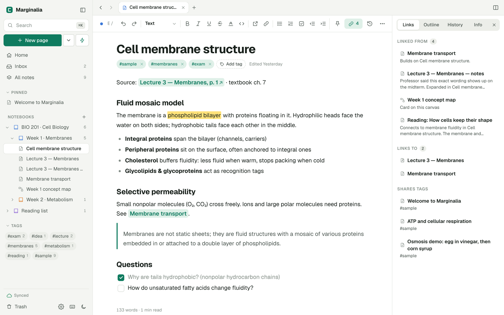
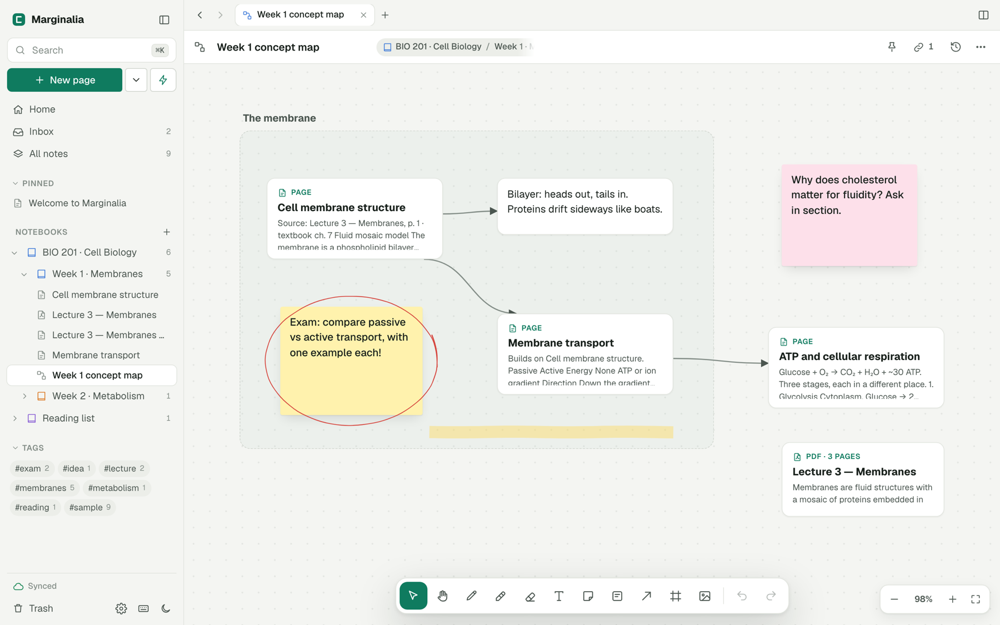
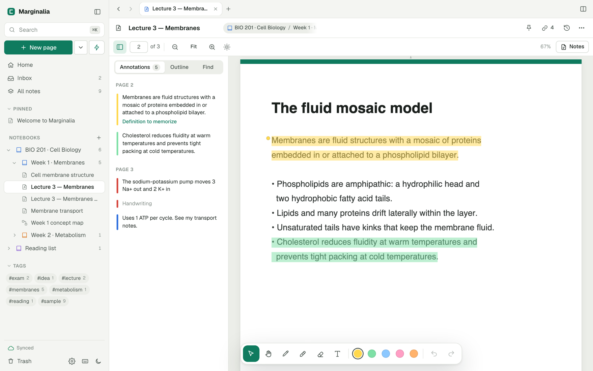
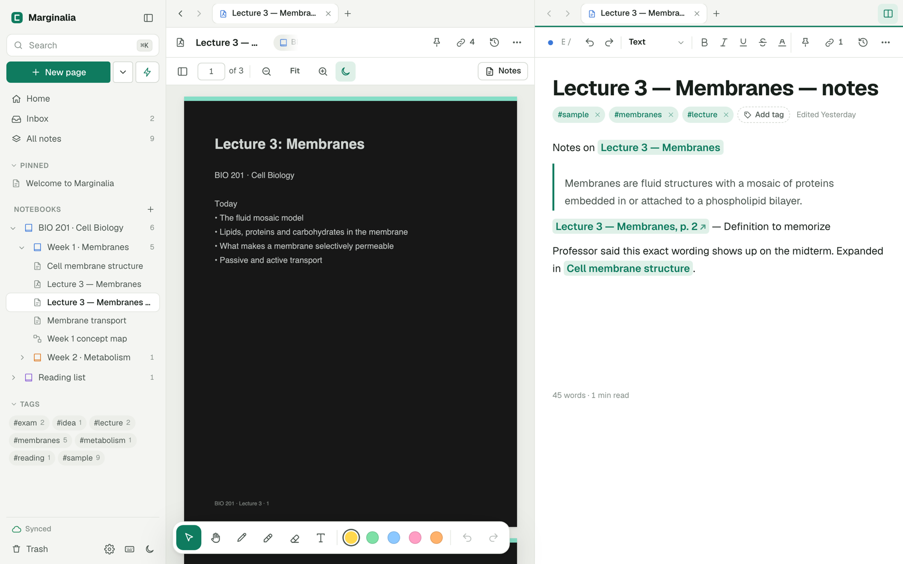
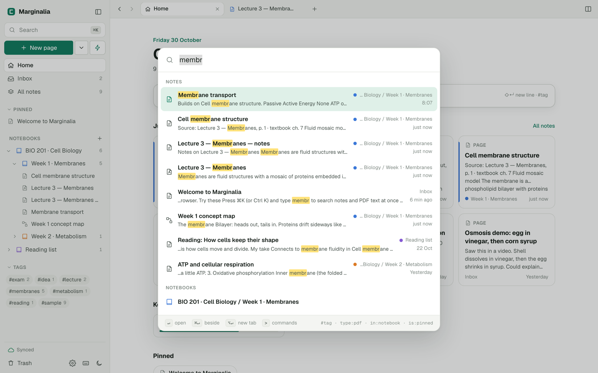

# Marginalia user guide

Marginalia is a notebook for studying from courses, lectures, articles and PDFs. This guide covers everything the app does, from your first note to syncing several devices.

To install or host the app, see the [README](../README.md). To learn how it's built, see the [technical architecture](architecture.md).

**A note on shortcuts.** This guide uses Mac keys. On Windows and Linux, `⌘` is `Ctrl`, `⌥` is `Alt` and `⇧` is `Shift`. Press `⌘/` in the app to see the shortcut list at any time.

## Contents

- [Getting started](#getting-started)
- [Organising your notes](#organising-your-notes)
- [Writing pages](#writing-pages)
- [Using the canvas](#using-the-canvas)
- [Reading and annotating PDFs](#reading-and-annotating-pdfs)
- [Searching and running commands](#searching-and-running-commands)
- [Tabs and split view](#tabs-and-split-view)
- [Links and backlinks](#links-and-backlinks)
- [Quick capture](#quick-capture)
- [Version history](#version-history)
- [Importing and exporting](#importing-and-exporting)
- [Using several devices](#using-several-devices)
- [Stylus and touch](#stylus-and-touch)
- [Settings](#settings)
- [Keyboard shortcuts](#keyboard-shortcuts)
- [Troubleshooting](#troubleshooting)

## Getting started

### Your first look

The first time you open Marginalia, it adds a small set of sample notes about cell biology, so you can try each feature on something realistic. When you're done with them, go to **Settings → Your data → Sample notes** and choose to remove them. They move to the Trash, along with the sample notebooks if those end up empty.

The window has three main areas:

- **The sidebar** on the left holds search, the **New page** button, your notebooks, tags and the Trash. Hide it with `⌘\`.
- **The workspace** in the middle shows tabs across the top and the open note below.
- **The details panel** on the right is optional. It shows a note's links, outline, history and info. Toggle it with `⌘⇧I`.

The **Home** view is your starting point. It has a capture box, the notes you opened most recently under **Jump back in**, PDFs you're partway through under **Keep reading**, your pinned notes, recent edits, your Inbox and your notebooks.

### Three kinds of note

| Type | Best for | Create it with |
| --- | --- | --- |
| **Page** | Written notes, with headings, lists, tables, code and sketches | `⌥N`, or **New page** |
| **Canvas** | Concept maps and anything spatial | `⌥C`, or the arrow next to **New page** |
| **PDF** | Slides, papers and textbooks you want to mark up | `⌥P`, or drag a PDF into the window |

New notes land in the notebook you're currently looking at. If you aren't in a notebook, they go to the Inbox.

Notes save automatically as you work, so there's no save button. `⌘S` does something different: it saves a named version in the note's history.

## Organising your notes

### Notebooks

Notebooks nest as deeply as you like, which suits a structure such as class, then chapter, then topic.

- **Create one** with the **+** next to **Notebooks** in the sidebar.
- **Add a section** by right-clicking a notebook and choosing **New notebook inside…**.
- **Move notes** by dragging them onto a notebook in the sidebar, or use **Move to…** from a note's **⋯** menu.
- **Move a notebook** by dragging it onto another one, or use **Move into…** from its menu.

Open a notebook to see its notes. Tick **Include sections** to see everything inside it, grouped by section, which gives you an overview of a whole class. You can filter and sort the list, and switch between list and card views.

Deleting a notebook never deletes notes. Its notes and sub-notebooks move up one level, or to the Inbox if it was a top-level notebook.

### Notebook colours

Colours make it easy to see which class a note belongs to. Right-click a notebook in the sidebar, or use the **⋯** button on its page, and pick a colour under **Colour**.

A section with no colour of its own uses its parent's, so colouring a class colours everything inside it. You can give any section its own colour to override that. The first swatch returns a notebook to **Same as parent**, or **No colour** if the parent has none.

The colour appears on notebook icons, tabs, the bar on note cards, dots beside notebook names, and in search results.

### Tags

Tags cut across notebooks. Add one with **Add tag** under a note's title, or type `#tag` in Quick capture. Tags are lowercase, and spaces become hyphens.

All your tags appear in the sidebar with a count. Click one to see its notes. On that page, **Rename tag** renames it on every note that uses it.

You can nest tags with a slash, as in `exam/midterm`. Searching for `#exam` then also finds notes tagged `exam/midterm`.

### Pinned notes

Pin a note with the pin icon at the top of the note. Pinned notes appear at the top of the sidebar and on Home.

### Inbox

The Inbox holds every note that isn't in a notebook, including anything you capture quickly. On Home, the **File** button beside an Inbox note moves it into a notebook.

### Trash

**Move to Trash** is in each note's **⋯** menu, and a message offers **Undo** straight afterwards. Notes stay in the Trash until you delete them, and you can restore them from there. **Delete forever** and **Empty Trash** can't be undone, and they also remove the note's version history.

## Writing pages

### The formatting toolbar

The toolbar sits under the tabs. From left to right it has undo and redo, a block style menu, bold, italic, underline, strikethrough, highlight, inline code, web link, note link, lists, indent controls and code block. The **Insert** menu adds tables, dividers, callouts, sketches, images and today's date.

On narrow windows, some of these move out of view. If you prefer a cleaner page, turn off **Settings → Writing → Formatting toolbar**, and a smaller toolbar appears over selected text instead.

The bottom of each page shows its word count and reading time.

### Markdown shortcuts

Type these at the start of a line, then press space:

| Type | To get |
| --- | --- |
| `#`, `##`, `###` | Headings |
| `-`, `*` or `+` | Bullet list |
| `1.` or `1)` | Numbered list |
| `[]`, `[ ]` or `- [ ]` | Checklist (`[x]` starts it ticked) |
| `>` | Quote |

Type three backticks and a space for a code block. Type `---` on its own line and press Enter for a divider.

These work inside a line:

| Type | To get |
| --- | --- |
| `**bold**` | **bold** |
| `*italic*` or `_italic_` | *italic* |
| `` `code` `` | inline code |
| `==highlight==` | highlighted text |
| `~~strike~~` | ~~struck-through text~~ |
| `[[Note title]]` | a link to that note |

### The block menu

Type `/` to open the block menu, then keep typing to filter it. Use the arrow keys and Enter to choose. It offers headings, text, lists, checklists, quotes, callouts, code blocks, dividers, sketches, tables, images, a link to a note, and today's date.

### Checklists and tables

Click a checkbox to tick it, or press `⌘Enter` with the cursor on the item. In tables, `Tab` and `⇧Tab` move between cells.

`⌘Enter` also leaves a block, adding a new line after a quote, callout, code block or table.

### Web links

Web addresses become links as you type, and when you paste them. Click one to open it in a new browser tab. To link some text, select it and paste a URL, or use the link button in the toolbar. To remove a link, put the cursor in it and press the same button.

### Code blocks

Paste YAML, JSON, Terraform, shell commands, Python, SQL, a Dockerfile, JavaScript or HTML, and Marginalia recognises it as code and puts it in a code block with every space intact. If you wanted plain text instead, choose **Paste as text** in the message that appears.

Inside a code block:

- Enter keeps the current indentation, and adds a level after `:`, `{`, `[` or `(`.
- `Tab` adds two spaces, and `⇧Tab` removes them.
- The bar on the block lets you set the language and copy the code.

Code blocks don't colour the syntax. The language setting is a label, and it's also used in Markdown exports.

### Images

Paste or drag an image into a page, or use **Insert → Image…**. Images are stored inside the note, scaled so the longest side is at most 1,600 pixels.

Click an image to select it. Drag a corner to resize it, or use the buttons for 25%, 50%, 75%, full width and original size, plus centring and delete. Sizes are stored as a percentage of the page width, so images fit any window.

### Sketches

Choose **Sketch** from the `/` menu to add a drawing area to a page. It has a pen, highlighter, eraser and colours, and you can drag its bottom edge to change its height. It works with a mouse, but a stylus gives you pressure-sensitive lines.

### Templates

The arrow next to **New page** offers starting structures: **Lecture notes**, **Cornell notes**, **Article / reading notes**, **Problem set** and **Weekly review**.

## Using the canvas

A canvas is an endless surface for arranging ideas. Choose tools from the bar at the bottom, or use the keyboard:

| Key | Tool | What it does |
| --- | --- | --- |
| `V` | Select | Click to select, drag to move, drag on empty space to select several |
| `H` | Pan | Move around the canvas |
| `P` | Pen | Draw, in six colours and three sizes |
| `M` | Highlighter | Draw translucent marks |
| `E` | Eraser | Remove ink strokes |
| `T` | Text card | Add a plain text card |
| `S` | Sticky note | Add a coloured note |
| `N` | Note card | Add a card showing one of your notes |
| `A` | Connect cards | Drag from one card to another to draw an arrow |
| `F` | Frame | Drag to draw a labelled group |

**Moving around.** Hold `Space` and drag to pan, or drag with the middle mouse button. Pinch with two fingers on a touch screen. `⌘` plus scroll zooms, and `⇧1` zooms to fit everything.

**Adding things.**
- Double-click empty space for a text card.
- Drag a note from the sidebar to add it as a note card.
- Paste text or images, or drag in image files.
- Drag in a PDF to import it and add it as a card.

**Working with cards.**
- Double-click or press Enter to edit a card. Double-clicking a note card opens the note.
- `⌘D` duplicates the selection, and so does `⌥`-dragging it.
- `⌘A` selects everything.
- Arrow keys nudge the selection.
- Moving a frame moves everything inside it.
- `⌘Z` undoes and `⌘⇧Z` redoes.

Text on cards can include `[[Note title]]` links and web addresses. Note cards count as links, so they show up in that note's backlinks.

## Reading and annotating PDFs

Import PDFs with `⌥P`, or drag them into the window. Marginalia remembers your page in each PDF, shows your reading progress, and searches the text of every page. Scanned PDFs without a text layer can be read and drawn on, but they have no text to select or search.

### Highlighting

Select text with the Select tool, and a small toolbar appears. From there you can:

- Pick a highlight colour, or press `1` to `5` for the five colours.
- Underline or strike through the text.
- Copy it.
- Choose **To notes** to highlight it and quote it into this PDF's notes page.

Click any annotation to change its colour, add a comment or delete it.

### Writing and drawing

| Key | Tool |
| --- | --- |
| `V` | Select text and annotations |
| `H` | Pan |
| `P` | Pen |
| `M` | Highlighter |
| `E` | Eraser |
| `T` | Text box |

`⌘Z` and `⌘⇧Z` undo and redo your marks. Annotations belong to the page, so they stay in place at any zoom level.

### Moving around a PDF

The sidebar button at the left of the PDF toolbar opens three panels:

- **Annotations** lists every mark by page. Click one to jump to it.
- **Outline** shows the PDF's table of contents, if it has one.
- **Find** searches this PDF. `⌘F` opens it directly.

Type a page number in the page box to jump there. `⌘=` and `⌘-` zoom, `⌘0` fits the width, and `⌘` plus scroll also zooms.

### The notes page

The **Notes** button opens a page note linked to this PDF, side by side with it. Each **To notes** quote goes there along with a link back to the exact page.

### Dark pages

The sun or moon button in the PDF toolbar sets pages to **Light**, **Dark** or **Match app theme**. Dark mode flips text and backgrounds, and keeps figures, photos and diagrams in their original colours. An image covering more than 60% of a page counts as a scanned page, so it's darkened along with everything else.

This changes only how pages look on screen. Exports keep the original colours.

## Searching and running commands

Press `⌘K` from anywhere. With nothing typed, you see your recent notes, so it doubles as a quick switcher. As you type, it searches note titles, text, tags, and the text of every PDF page, and it tolerates small typos in longer words.

| Key | What it does |
| --- | --- |
| Enter | Open the result |
| `⌘Enter` | Open it beside the current note |
| `⌥Enter` | Open it in a new tab |
| `Tab` | Switch between search and commands |

A PDF result opens at the page that matched. If no note has the title you typed, the last result creates a new page with that title.

### Search filters

Add these to narrow your results:

| Filter | Finds |
| --- | --- |
| `#exam` | Notes with that tag, including nested tags such as `exam/midterm` |
| `type:pdf` | One note type: `page`, `canvas` or `pdf` |
| `in:biology` | Notes in a notebook whose path contains that word |
| `in:"week 1"` | The same, for names with spaces |
| `is:pinned` | Pinned notes |

Filters combine, so `mitosis #exam type:pdf` finds PDFs tagged `exam` that mention mitosis.

### Commands

Press `⌘⇧P`, or type `>` in the search box, to run a command by name. Commands include creating notes, using templates, changing themes, exporting the current note, downloading a backup and opening settings.

## Tabs and split view

Each tab keeps its own back and forward history.

| Action | Shortcut |
| --- | --- |
| New tab | `⌥T` |
| Close tab | `⌥W` |
| Go to tab 1 to 9 | `⌥1` to `⌥9` |
| Back and forward | `⌘[` and `⌘]` |
| Jump to the previous note | `` ⌥` `` |
| Toggle split view | `⌘⇧\` |

Hold `⌘` and click a note or link to open it in the other pane, which is how you put a PDF beside your notes or compare two pages. Drag a tab into the other pane's tab bar to move it there. Your open tabs are remembered between visits.

## Links and backlinks

Linking notes builds a web of what you've learned.

**Create a link** in any of these ways:

- Type `[[`, then choose a note from the list.
- Type `[[Note title]]` in full. If no note has that title, Marginalia creates one.
- Type `[[Note title|the text to show]]` to choose the link's wording.
- Use the link button in the toolbar, or `⌘⇧L` on selected text.

**See connections** in the **Links** tab of the details panel, opened with the link icon at the top of a note. It shows:

- Notes that link to this one, with the surrounding text.
- Notes this one links to.
- Notes that share a tag.
- Notes that mention this note's title without linking to it. You can turn those mentions into links there.

The **Outline** tab lists a page's headings for quick jumping, and the **Info** tab shows dates, word counts and link counts.

## Quick capture

Press `⌘⇧Space` (or `⌥Q`) from anywhere to jot something down without leaving what you're doing.

- **New note.** The first line becomes the title, and any `#tags` you type are added to the note. It goes to the Inbox unless you choose a notebook.
- **Add to a note.** Your text goes at the end of a page you choose, with a timestamp.

`⌘Enter` saves, and `⌘⇧Enter` saves and opens the note. The box at the top of Home works the same way for new notes: Enter saves and `⇧Enter` adds a line.

## Version history

Every note keeps its own history, in the **History** tab of the details panel or behind the clock icon at the top of a note.

- **Automatic versions** are kept while you edit, every 10 minutes by default, and when you leave a note you changed. Change the interval under **Settings → Writing → Automatic versions**. Each note keeps its latest 150 or so automatic versions.
- **Saved versions** are created with `⌘S`, with an optional label such as "Before exam edits". These are never removed automatically.

Click a version to compare it. **Changes** shows the words added and removed since that version, and **This version** shows it in full. **Restore this version** first saves your current state, so restoring can itself be undone.

For pages, the comparison covers text. For canvases and PDFs, it covers card text and annotations.

## Importing and exporting

### Importing

Drag files into the window, or use **Import files…** from the arrow next to **New page**.

| Format | Result |
| --- | --- |
| PDF (`.pdf`) | A PDF note |
| Markdown (`.md`, `.markdown`) | A page. `title` and `tags` in the front matter are used, and a leading `# Heading` becomes the title |
| Text (`.txt`) | A page |
| HTML (`.html`, `.htm`) | A page, cleaned of scripts and styles |
| Backup (`.zip`) | Restores a Marginalia backup |

**Import a folder of Markdown…** keeps the folder's structure, turning each folder into a notebook. This is the easiest way to bring in notes from another app that exports Markdown.

Imported files go into the notebook you're viewing. PDFs that are password-protected or damaged can't be imported.

### Exporting a note

Open a note's **⋯** menu and look under **Export**.

| Note type | Formats |
| --- | --- |
| Page | Markdown, web page, Word (`.doc`), plain text, print or save as PDF |
| Canvas | PNG image, SVG vector, Markdown outline, canvas data (JSON) |
| PDF | PDF with annotations, original PDF, highlights and notes as Markdown |

**PDF with annotations** builds your marks into the file, so they show in any PDF reader. Text boxes in that export use a standard Western font, so characters outside it, such as Greek or Chinese, appear as `?`.

### Exporting a notebook

**Export as ZIP** in a notebook's menu saves its notes in folders that match your notebooks: pages as Markdown, canvases as PNG plus an outline, and PDFs with their annotations.

### Backups

Go to **Settings → Your data**:

- **Download full backup** saves everything in one ZIP: notes, notebooks, versions, PDF text and PDFs. Settings and open tabs aren't included.
- **Restore from backup** merges a backup into your notes. It adds notes you don't have and replaces yours only where the backup's copy is newer.
- **Export everything as Markdown + PDFs** gives you a readable copy that's useful outside Marginalia, but it can't be restored as a backup.

If you don't use a sync server, your notes live only in that browser. Clearing the browser's site data deletes them, so download backups regularly.

## Using several devices

To sync, every device needs to open the app from the same running copy of `serve.py`. The [README](../README.md#self-hosting) explains how to host it.

Each browser keeps a full copy of your notes. It syncs every 30 seconds, shortly after each edit, and when you come back online. The status is at the bottom of the sidebar:

| Status | Meaning |
| --- | --- |
| **Synced** | Everything is saved on the server |
| **Syncing…** | Sync is in progress |
| **N waiting** | Changes are queued to upload |
| **Offline** | The server can't be reached; changes wait in this browser |
| **Needs sync token** | Enter the server's token under **Settings → Sync** |
| **Sign-in expired** | Reload the page to sign in again |
| **Sync problem** | The server returned an error; see **Settings → Sync** |

If the status doesn't appear at all, the app isn't connected to a sync server, and notes stay in this browser.

**Working offline.** A tab that's already open keeps working if your connection drops, and your changes upload when it returns. Loading the app from scratch needs the server to be reachable, because the app's files come from there.

**Conflicts.** If two devices change the same note before syncing, the newest change wins. The other isn't lost: it's kept in the note's version history, labelled **From another device**.

**What syncs.** Notes, notebooks, version history, PDF text and PDFs sync. Settings, theme and open tabs are separate for each browser. PDFs download to a new device the first time you open them.

## Stylus and touch

Marginalia works well on tablets, and supports pressure-sensitive pens such as Apple Pencil.

With **Settings → Stylus and touch → Pen draws, finger scrolls** turned on, which is the default:

- On PDFs, the pen writes even with the Select or Pan tool active.
- Fingers scroll and pan rather than drawing, so your palm doesn't leave marks.

The eraser end of a stylus erases in PDFs and on canvases, where the hardware supports it.

Turn this setting off to draw with your finger.

## Settings

Open Settings with the gear icon at the bottom of the sidebar.

| Section | Options |
| --- | --- |
| **Appearance** | Theme, writing font (sans, serif or mono), PDF page colour, page width |
| **Stylus and touch** | Pen draws, finger scrolls |
| **Writing** | Formatting toolbar, spellcheck, automatic version interval |
| **Home** | Which sections appear on Home |
| **Sync** | Status, **Sync now**, and the sync token |
| **Your data** | Backup, restore, export, import, storage used, sample notes |

## Keyboard shortcuts

### Everywhere

| Shortcut | Action |
| --- | --- |
| `⌘K` or `⌘P` | Search and switch notes |
| `⌘⇧P` | Command palette |
| `⌘⇧Space` or `⌥Q` | Quick capture |
| `⌘/` | Show keyboard shortcuts |
| `⌥N` | New page |
| `⌥C` | New canvas |
| `⌥P` | Import PDF |
| `⌘S` | Save a named version |
| `⌘\` | Toggle sidebar |
| `⌘⇧\` | Toggle split view |
| `⌘⇧I` | Toggle the details panel |
| `⌘[` and `⌘]` | Back and forward |
| `` ⌥` `` | Jump to the previous note |
| `⌥T` and `⌥W` | New tab and close tab |
| `⌥1` to `⌥9` | Go to a tab |
| `⌘`-click | Open a link in the other pane |

### Pages

| Shortcut | Action |
| --- | --- |
| `⌘B`, `⌘I`, `⌘U` | Bold, italic, underline |
| `⌘⇧X` | Strikethrough |
| `⌘⇧H` | Highlight |
| `⌘E` | Inline code |
| `⌘⇧L` | Link selection to a note |
| `⌘⌥1` to `⌘⌥3` | Headings 1 to 3 |
| `⌘⌥0` | Body text |
| `⌘⇧7`, `⌘⇧8`, `⌘⇧9` | Numbered list, bullet list, checklist |
| `⌘Enter` | Toggle a checkbox, or leave the current block |
| `Tab` and `⇧Tab` | Indent and outdent lists and code; move between table cells |

### Canvas

| Shortcut | Action |
| --- | --- |
| `V` `H` `P` `M` `E` | Select, pan, pen, highlighter, eraser |
| `T` `S` `N` `A` `F` | Text, sticky, note card, arrow, frame |
| `Space` + drag | Pan |
| `⌘` + scroll | Zoom |
| `⌘=`, `⌘-`, `⌘0` | Zoom in, zoom out, 100% |
| `⇧1` | Zoom to fit |
| `⌘A`, `⌘D` | Select all, duplicate |
| Arrow keys | Nudge the selection |
| Delete | Delete the selection |
| `⌘Z`, `⌘⇧Z` | Undo, redo |

### PDFs

| Shortcut | Action |
| --- | --- |
| `V` `H` `P` `M` `E` `T` | Select, pan, pen, highlighter, eraser, text box |
| `1` to `5` | Highlight the selected text in that colour |
| `⌘F` | Find in this PDF |
| `⌘=`, `⌘-`, `⌘0` | Zoom in, zoom out, fit width |
| `←` and `→` | Previous and next page, when the Select tool isn't active |
| Delete | Delete the selected annotation |
| `⌘Z`, `⌘⇧Z` | Undo, redo |

## Troubleshooting

**The app looks out of date after an update.** Press `⌘⇧R` to force a fresh load. If you use Cloudflare, add the cache rule described in the [README](../README.md#truenas-scale-with-an-optional-cloudflare-tunnel).

**The sidebar says "Needs sync token".** The server requires a token. Enter it under **Settings → Sync**. You need to do this once in each browser.

**The sidebar says "Sign-in expired".** Your login in front of the server, such as Cloudflare Access, has ended. Reload the page and sign in.

**Notes from another device aren't showing up.** Check that both devices use exactly the same address. Each address counts as a separate browser location, so notes made at `localhost` aren't on a server you later reach through a domain name. To move them, use **Download full backup** at the old address and **Restore from backup** at the new one.

**A note I deleted forever came back.** This can happen after a server is reset or replaced, because each browser uploads what it holds. A browser that hadn't synced your deletion restores the note. Delete it again.

**An edit seems to have gone.** Open the note's **History** tab and look for **From another device**. Opening a note also counts as a change to it, so an edit made offline can lose to a device that only opened the note later. The edit is still in the history.

**A banner says storage is blocked.** The browser is refusing to store data, which often happens in private windows. Notes won't survive closing the page. Use a normal window.

**A PDF won't import.** It may be damaged or password-protected. Remove the password in another app, then import it again.

**A PDF on a second device won't open.** PDFs download the first time you open them, so that device needs to reach the server.

**The app won't load at all.** It needs the server to be reachable. On a first visit, it also needs internet access to download its libraries from jsDelivr.
